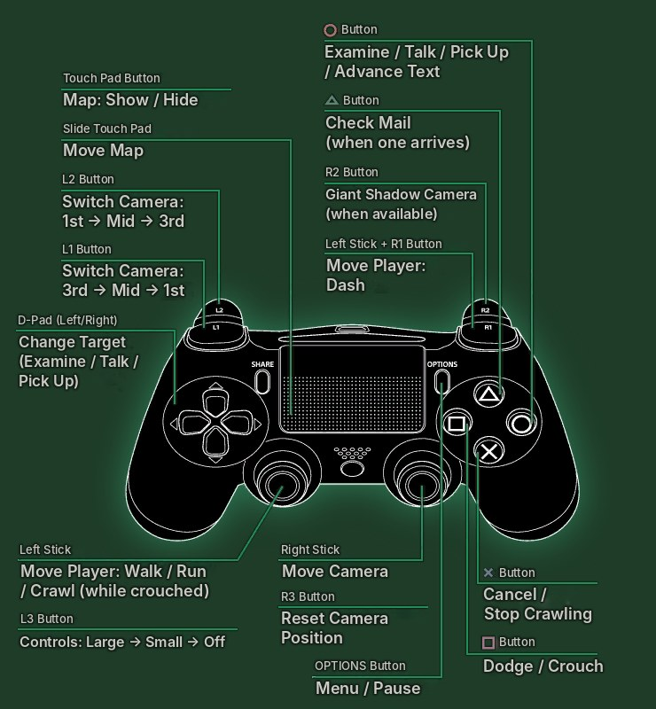
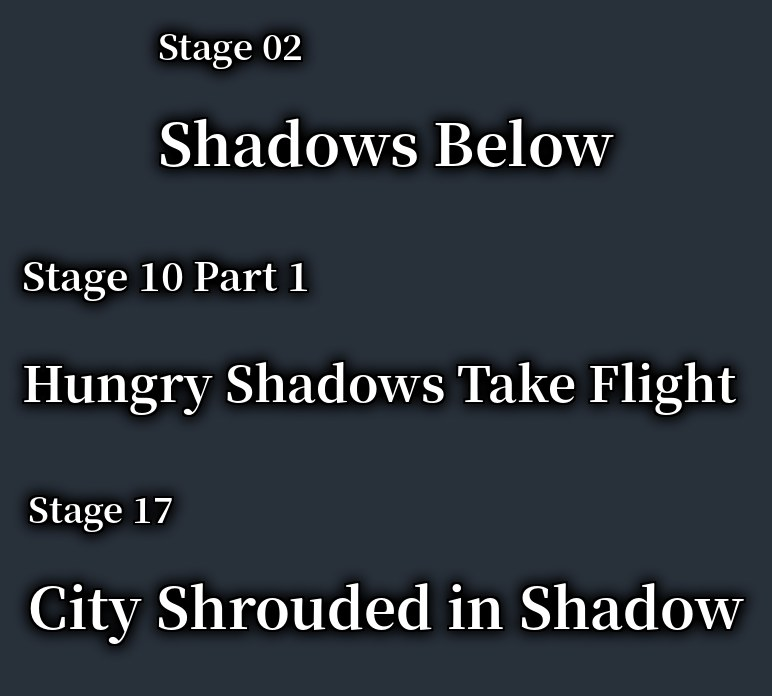
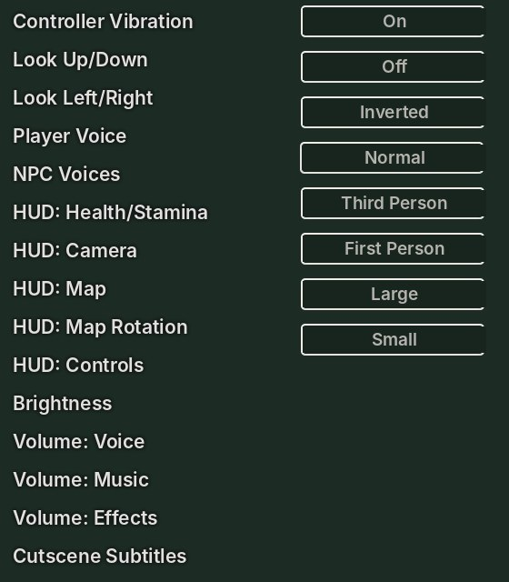
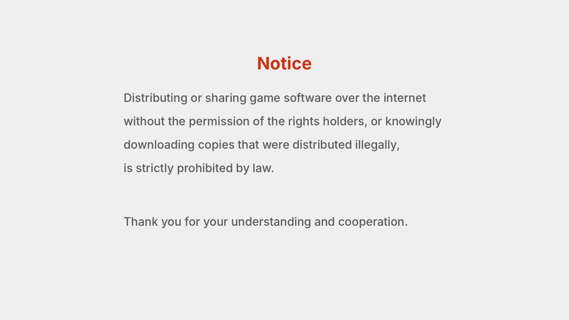

# City Shrouded in Shadow — English Translation

Unofficial English fan translation of **巨影都市 (Kyoei Toshi / City Shrouded in Shadow)**, the 2017 PS4 disaster-survival game by Granzella and Bandai Namco, which was only released in Japan and Asia.

**Current release: v1.0** — download it from the [Releases page](https://github.com/waifoof/City-Shrouded-in-Shadow-English-Translation-/releases/latest).

Target: Japanese PS4 release **CUSA03562** with update **01.03**.

| | |
|---|---|
|  |  |
|  |  |

## What's translated

- All story dialogue, NPC conversations, choices and **speaker names**
- Items, readable materials, mail, missions, shop, records, save data and checkpoints
- KYOEI NEWS articles, loading-screen story recaps and the ending monologue
- Menus, HUD, interaction prompts, system messages and staff credits
- **168 redrawn images**: the options menu, every controller layout (on foot, car, bike, forklift, horse and the special scenes), item menu tabs, stage title and stage-clear cards, struggle and shake-off prompts, intermission screen buttons and the boot notices

The script also went through a full line-by-line review pass against the Japanese.

Left in Japanese on purpose: signage inside scene artwork and news photos, logos, developer placeholder images, and internal names that never appear in play.

## Status

- The text translation (everything except the redrawn images) has been played on a jailbroken PS5 (firmware 13.00, ShadowMountPlus) and works.
- v1.0 adds the redrawn images. These pass every desktop check, but confirmation on a console is still pending. Please report anything odd.
- shadPS4: the game currently crashes during boot on the emulator, with or without the patch.

## How it works

The release contains **no game files**. It has the English text, small binary patches for the redrawn images (useless without the original files), and scripts that apply everything to *your own* untranslated 1.03 files. Every input is checked against known hashes, so a wrong region, version or already-modified file is refused rather than silently broken.

## Installing

You need your own base game PKG and the original Japanese 1.03 update PKG, Python 3.11+, PowerShell 7.4+, a PKG extractor (e.g. PS4 PKG Tool) and [LibOrbisPkg](https://github.com/maxton/LibOrbisPkg) PkgTool.

1. **Make the English files.** Extract `eboot.bin` and `DAT/common.psarc` from the original 1.03 update, then run:
   ```powershell
   Set-ExecutionPolicy -Scope Process Bypass
   .\Apply-English.ps1 -UpdateFolder 'X:\Original103' -WorkDirectory 'X:\Work'
   ```
   The English files are written to `X:\Work\overlay\`.
2. **Merge the base game and update** into one folder. In PS4 PKG Tool, use *Install to shadPS4* on the base PKG and then on the 1.03 update.
3. **Write the build project:**
   ```powershell
   python scripts\make_full_gp4.py --game-folder 'X:\...\CUSA03562' --overlay 'X:\Work\overlay' --output 'X:\WorkFull'
   ```
4. **Build the PKG:**
   ```powershell
   PkgTool.exe pkg_build 'X:\WorkFull\CUSA03562-English-Full.gp4' 'X:\WorkFull\package'
   ```
5. **Install it.**
   - **PS5 (ShadowMountPlus):** in PS4 PKG Tool, choose *Convert to FFPFSC* and mount the result.
   - **PS4:** install the PKG with your usual fake-PKG installer.

Full instructions, including the alternative update-PKG route for PS4, are in [`kit/README.txt`](kit/README.txt). [`kit/CONSOLE-CHECKLIST.txt`](kit/CONSOLE-CHECKLIST.txt) lists what to look at when testing.

## Repository layout

| Path | Contents |
|---|---|
| `kit/` | The release kit: translations, image patches, apply/verify scripts |
| `tools/translation/` | Authoring pipeline: recaps, ending, executable, HUD, credits and speaker-name sources, `merge.py` |
| `tools/textures/` | Texture decoder, BC3 encoder and redraw scripts used for the images |
| `docs/` | Glossary and style guide, technical notes |

## Reporting problems

Open an issue with a screenshot, where it happened (stage, menu, scene), and what you expected. Lines that are still Japanese, cut off or overlapping are all useful.

## Legal

This is an unofficial, non-commercial fan project with no affiliation with Bandai Namco Entertainment, Granzella, or the owners of the featured series. Game names, text and artwork belong to their respective owners. No game data is distributed. Please own the game and support the official release.
